# 🌱 AgriSense AI – Hybrid Crop Advisor

AgriSense AI is a machine learning-based crop recommendation system that helps users identify suitable crops based on soil nutrients and weather conditions.

The system combines a trained Random Forest classification model with a preliminary rule-based regional recommendation approach to provide crop suggestions using agricultural and environmental parameters.

## ✨ Features

- Crop recommendations based on soil and weather parameters
- Soil nutrient inputs: Nitrogen (N), Phosphorus (P), and Potassium (K)
- Temperature, humidity, pH and rainfall inputs
- Random Forest-based crop prediction
- Top-three crop recommendations with model probability estimates
- Weather information using the Open-Meteo API
- Preliminary regional crop shortlist based on state, season and irrigation
- Crop information endpoint
- REST API built with FastAPI
- Deployed backend API on Vercel

## 🛠️ Tech Stack

- **Frontend:** React
- **Backend:** Python, FastAPI
- **Machine Learning:** Scikit-learn, Random Forest Classifier
- **Data Processing:** Pandas, NumPy
- **Model Storage:** Joblib
- **Data Format:** CSV, JSON
- **External API:** Open-Meteo
- **Deployment:** Vercel

## 📁 Project Structure

```text
agrisense-ai/
│
├── api/
│   └── index.py
│
├── data/
│   └── Crop_recommendation.csv
│
├── models/
│   ├── crop_model.joblib
│   └── metrics.json
│
├── main.py
├── train.py
├── requirements.txt
├── vercel.json
└── README.md
```

## ⚙️ Input Parameters

The machine learning model uses seven input parameters:

| Parameter | Description |
|---|---|
| Nitrogen (N) | Nitrogen content in soil |
| Phosphorus (P) | Phosphorus content in soil |
| Potassium (K) | Potassium content in soil |
| Temperature | Environmental temperature |
| Humidity | Relative humidity |
| pH | Soil pH level |
| Rainfall | Rainfall measurement |

## 🧠 Machine Learning Workflow

AgriSense AI uses a Random Forest Classifier to predict suitable crop classes.

### Model Training

The training process implemented in `train.py` includes:

1. Loading the crop recommendation dataset using Pandas.
2. Checking required columns and handling missing values.
3. Separating input features and target labels.
4. Splitting the dataset into training and testing sets using an 80:20 ratio.
5. Applying stratified sampling to preserve class distribution.
6. Training a Random Forest Classifier with 300 estimators.
7. Evaluating the model using accuracy and macro F1-score.
8. Saving the trained model and evaluation metrics using Joblib and JSON.

### Model Evaluation

The model was evaluated on a held-out test dataset.

| Metric | Result |
|---|---:|
| Test Accuracy | 99.32% |
| Test Macro F1-Score | 99.32% |
| Dataset Rows Used | 2,200 |
| Crop Classes | 22 |

**Evaluation configuration:**
- Train-test split: 80:20
- Random State: 42
- Stratified sampling
- Algorithm: Random Forest Classifier
- Number of estimators: 300

Evaluation results are stored in `models/metrics.json`.

*Note: These metrics represent performance on the held-out test portion of the dataset. They do not guarantee equivalent performance under real-world agricultural conditions.*

## 🌾 Recommendation Approaches

AgriSense AI provides two different recommendation approaches.

### 1. Machine Learning-Based Crop Recommendation

The `/api/recommend` endpoint uses the trained Random Forest model.

- Accepts seven soil and weather parameters.
- Generates crop predictions using the trained model.
- Returns the top three predicted crop classes.
- Includes model probability estimates for each recommendation.

### 2. Rule-Based Regional Crop Shortlist

The `/api/hybrid-recommend` endpoint generates a preliminary crop shortlist using:

- Location
- State
- Growing season
- Irrigation type

This is an early prototype based on illustrative regional rules. It does not currently use the trained ML model or infer soil properties from location.

**Important:** Regional crop candidates require validation against current official district-level agricultural recommendations before real-world use.

## 🏗️ System Architecture

The project follows a frontend-backend architecture with a separate offline model training workflow.

```mermaid
flowchart TD
    A["User / Browser"]
    B["React Frontend"]
    C["FastAPI Backend"]
    
    A --> B
    B <-->|"HTTP / JSON"| C

    subgraph API["Backend Services"]
        C --> D["Pydantic Input Validation"]
        D --> E["POST /api/recommend"]
        E --> F["Random Forest Model"]
        F --> G["Top 3 Crop Predictions"]

        C --> H["GET /api/weather"]
        H --> I["Open-Meteo API"]

        C --> J["POST /api/hybrid-recommend"]
        J --> K["Regional Rule-Based Logic"]

        C --> L["Crop Information"]
        C --> M["Model Metrics"]
    end

    subgraph TRAINING["Offline Model Training"]
        N["Crop Recommendation Dataset"]
        O["train.py"]
        P["Random Forest Training"]
        Q["crop_model.joblib"]
        R["metrics.json"]

        N --> O --> P
        P --> Q
        P --> R
    end

    Q -.-> F
    R -.-> M
```



## 🚀 Getting Started

### 1. Clone the repository

```bash
git clone https://github.com/charitha0310/agrisense-ai.git
cd agrisense-ai
```

### 2. Create a virtual environment

```bash
python -m venv venv
```

### 3. Activate the environment

**Windows:**

```bash
venv\Scripts\activate
```

**macOS/Linux:**

```bash
source venv/bin/activate
```

### 4. Install dependencies

```bash
pip install -r requirements.txt
```

### 5. Train the machine learning model

Make sure the dataset is available at:

```text
data/Crop_recommendation.csv
```

Run:

```bash
python train.py
```

This generates the trained model and evaluation metrics inside the `models/` directory.

If the trained model is already available, this step can be skipped.

### 6. Start the FastAPI server

```bash
uvicorn main:app --reload
```

### 7. Access the application API

- API Base URL: http://127.0.0.1:8000
- Interactive API Documentation: http://127.0.0.1:8000/docs
- Health Check: http://127.0.0.1:8000/api/health

## 🔌 API Endpoints

The deployed backend provides the following endpoints:

| Method | Endpoint | Description |
|---|---|---|
| GET | `/` | API status |
| GET | `/api/health` | Backend and model health check |
| GET | `/api/metrics` | Retrieve model evaluation metrics |
| POST | `/api/recommend` | ML-based crop recommendations |
| GET | `/api/weather` | Retrieve weather information by city |
| GET | `/api/crops/{crop_name}` | Retrieve general crop information |
| POST | `/api/hybrid-recommend` | Generate a preliminary regional crop shortlist |

## 🧪 API Testing

The deployed backend was tested successfully using FastAPI Swagger UI.

Verified functionality includes:

- Model loading and health check
- Retrieval of model evaluation metrics
- ML-based crop prediction
- Weather information retrieval
- Crop information retrieval
- Rule-based hybrid recommendation

### Sample Prediction Result

For one test input, the model returned:

| Crop | Model Score |
|---|---:|
| Rice | 0.9567 |
| Jute | 0.0433 |
| Apple | 0.0000 |

These are model probability estimates, not guaranteed real-world crop suitability percentages.

## 🌐 Deployment

**Frontend:** https://frontend-brown-three-43.vercel.app

**Backend API:** https://agrisense-backend-three.vercel.app

**Interactive API Documentation:** https://agrisense-backend-three.vercel.app/docs

**Backend Health Check:** https://agrisense-backend-three.vercel.app/api/health

## 🔮 Future Improvements

- Improve model generalisation through further experimentation and validation.
- Incorporate more region-specific agricultural datasets.
- Validate regional recommendations using official agricultural advisories.
- Improve frontend and backend integration.
- Enhance weather updates when users change locations.
- Add more detailed crop insights and visualisations.

## 👩‍💻 Author

**Rasamalla Charitha**

- GitHub: https://github.com/charitha0310
- Project: AgriSense AI – Hybrid Crop Advisor

---

*AgriSense AI – Making crop recommendations smarter through machine learning.*
